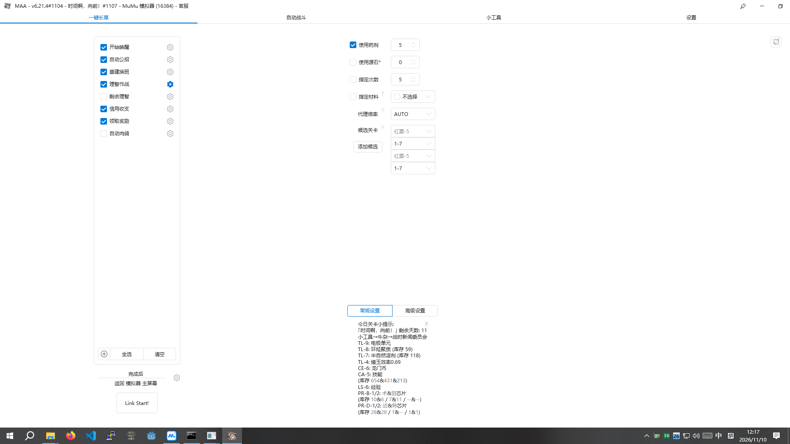
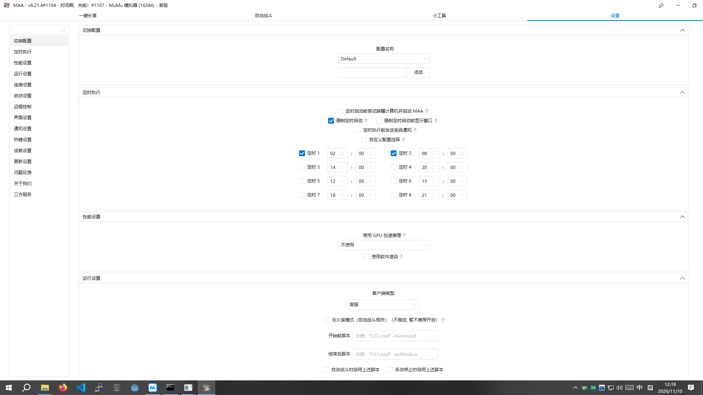
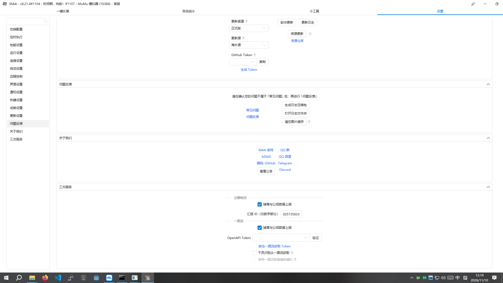
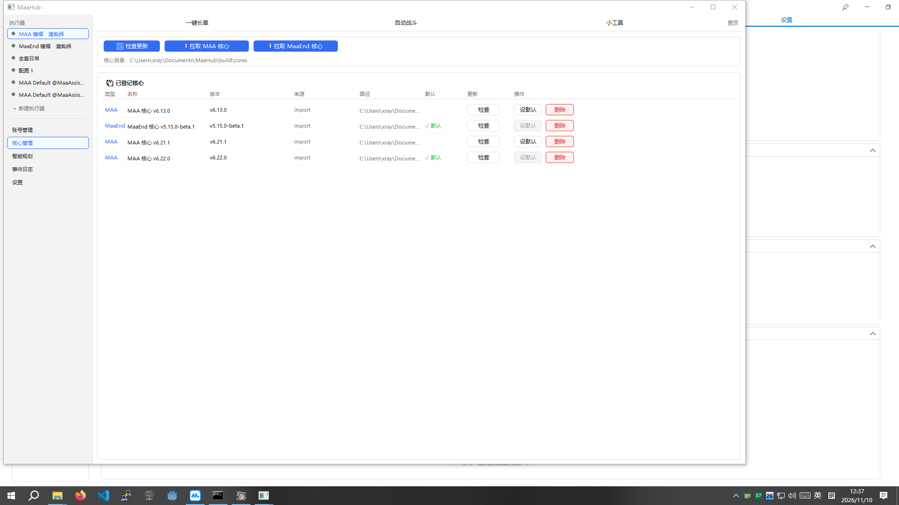

# MaaHub 核心管理 vs MAA 原生 UI — 视觉对比冒烟测试

- 日期：2026-11-10
- 环境：ENG01（`10.10.226.8` / DESKTOP-P72CMPJ，Windows 10，1920×1080）
- MAA：`C:\Program Files\MaaAssistantArknights_5\MAA.exe`，**v6.21.4#1104**
- MaaHub：`C:\Users\xray\Documents\MaaHub\build\MaaHub.exe`（本次修复后重新编译）
- 方法：远端 session 1 实机截图 + 配置双源对照（`gui.json` vs `gui.new.json`）+ CLI 导入回归

---

## 1. 结论摘要

| # | 项 | 判定 |
|---|---|---|
| 1 | 核心版本展示 | **PASS** — 双端都能正确显示版本 |
| 2 | 多核心管理（Maa/maaend 并存） | **PASS** — MaaHub 独有能力，MAA 无 |
| 3 | 默认核心标记与切换 | **PASS** — 默认绿标，默认行「设默认」置灰 |
| 4 | 更新检查入口 | **PASS** — 双端都有，MaaHub 多粒度更细 |
| 5 | 更新渠道/更新源选择 | **FAIL(P2)** — MAA 有「正式版/海外源」，MaaHub 无 |
| 6 | **配置导入的定时计划正确性** | **FAIL(P0) → 已修复并通过** |
| 7 | 设置页性能 | **FAIL(P1)** — 曾出现单帧 53 s |
| 8 | 表格可读性（重复列/截断） | **FAIL(P2)** — 名称列重复版本、路径截断 |
| 9 | 窗口可用性（默认尺寸/最大化） | **FAIL(P2)** — 1006×639 装不下 8 列，且无最大化按钮 |

**一句话**：核心管理页的能力面**超过** MAA 原生（多核心/设默认/删除/目录管理），但**配置导入读错了配置文件**，导致定时计划与 MAA 真实状态不一致 —— 这是本轮最重要的发现，已修复并回归验证。

---

## 2. MAA 原生 UI 实况

### 2.1 主界面（一键长草）



- 标题栏即版本载体：`MAA - v6.21.4#1104 - 时间啊，向前！#1107 - MuMu 模拟器 (16384) - 官服`
- 顶部 4 个导航：一键长草 / 自动战斗 / 小工具 / 设置
- 左栏任务复选清单（带齿轮），右栏参数表单，底部 `Link Start!`
- 右上角「热更数据获取失败 2026/11/10 12:16:34」（**环境问题**：`gui.json` 里 `VersionUpdate.Proxy = 127.0.0.1:10808` 已失效，非 MaaHub 缺陷）

### 2.2 设置页（切换配置 / 定时执行 / 性能 / 运行）



**定时执行区**（本测试的关键对照点）：

| 定时器 | 时间 | MAA 界面勾选 |
|---|---|---|
| 定时 1 | 02:00 | ☑ |
| 定时 2 | 08:00 | ☑ |
| 定时 3 | 14:00 | ☐ **未勾选** |
| 定时 4 | 20:00 | ☐ **未勾选** |
| 定时 5 | 12:00 | ☐ |
| 定时 6 | 15:00 | ☐ |
| 定时 7 | 18:00 | ☐ |
| 定时 8 | 21:00 | ☐ |

### 2.3 更新设置页



- 更新渠道：正式版 / 更新源：海外源
- 按钮：[软件更新] [更新日志] [资源更新] [资源仓库]
- **该页不显示版本号** —— MAA 的版本只在标题栏与「关于我们」

---

## 3. MaaHub 核心管理页实况



- 顶部：[🔄 检查更新] [↑ 拉取 MAA 核心] [↑ 拉取 MaaEnd 核心]
- `核心目录: C:\Users\xray\Documents\MaaHub\build\cores`
- 表格 8 列：类型 / 名称 / 版本 / 来源 / 路径 / 默认 / 更新 / 操作

| 类型 | 名称 | 版本 | 来源 | 默认 | 更新 | 操作 |
|---|---|---|---|---|---|---|
| MAA | MAA 核心 v6.13.0 | v6.13.0 | import | | [检查] | [设默认] [删除] |
| MaaEnd | MaaEnd 核心 v5.15.0-beta.1 | v5.15.0-beta.1 | import | ✅默认 | [检查] | [设默认(灰)] [删除] |
| MAA | MAA 核心 v6.21.1 | v6.21.1 | import | | [检查] | [设默认] [删除] |
| MAA | MAA 核心 v6.22.0 | v6.22.0 | import | ✅默认 | [检查] | [设默认(灰)] [删除] |

与 `state\final_cores.json` 完全一致（4 条、两处默认）。

---

## 4. 逐维度对照

### 4.1 版本信息

| 项 | MAA 原生 | MaaHub 核心管理 |
|---|---|---|
| 载体 | 窗口标题栏 | 表格「版本」列 |
| 数量 | 1（当前运行的那份） | 4（磁盘上所有已登记核心） |
| 粒度 | `v6.21.4#1104`（含 commit） | `v6.13.0` / `v5.15.0-beta.1` / `v6.21.1` / `v6.22.0` |
| 判定 | PASS | PASS（信息量更大） |

### 4.2 更新检查

| 项 | MAA 原生 | MaaHub |
|---|---|---|
| 入口 | 设置 → 更新设置 | 顶部 [检查更新] + 每行 [检查] |
| 渠道/源 | 正式版 / 海外源（可选） | 无（P2 缺失） |
| 粒度 | 全量（软件/资源分开） | 全部 + 单核心 |
| 判定 | PASS | PASS（但缺渠道选择） |

### 4.3 定时计划 —— **本轮核心缺陷**

| 项 | MAA 原生 | MaaHub（修复前） | MaaHub（修复后） |
|---|---|---|---|
| 数据源 | `config\gui.new.json` → `Timers.List[]` | `config\gui.json` → `Global.Timer.TimerN` | `gui.new.json` → `Timers.List[]` |
| Timer1 02:00 | ☑ | true ✓ | true ✓ |
| Timer2 08:00 | ☑ | true ✓ | true ✓ |
| **Timer3 14:00** | **☐** | **true ✗** | **false ✓** |
| **Timer4 20:00** | **☐** | **true ✗** | **false ✓** |
| Timer5-8 | ☐ | false ✓ | false ✓ |
| 判定 | — | **FAIL** | **PASS** |

**根因**：MAA 6.x 把配置从 `gui.json`（`{Configurations, Global}`）迁移到 `gui.new.json`（`{Configurations, Timers, Gui, ...}`）；旧文件保留但不再写。`config_import.hpp` 的 `resolve_config_path()` 硬编码只找 `config\gui.json`，于是读到 2026-11-05 的历史值（Timer1-4=true）。

**证据链**：

```
gui.json     1702B  2026-11-05 04:49  has Global=True  has Gui=False   Timer1-4=True
gui.new.json 18719B 2026-11-10 12:16  has Global=False has Gui=True    Timers.List[] 见下
```

```json
"Timers": { "List": [
  {"Id":0,"IsEnabled":true, "Config":"Default","Hour":2, "Minute":0},
  {"Id":1,"IsEnabled":true, "Config":"Default","Hour":8, "Minute":0},
  {"Id":2,"IsEnabled":false,"Config":"Default","Hour":14,"Minute":0},   // 旧文件是 true
  {"Id":3,"IsEnabled":false,"Config":"Default","Hour":20,"Minute":0},   // 旧文件是 true
  {"Id":4,"IsEnabled":false,"Config":"Default","Hour":12,"Minute":0},
  {"Id":5,"IsEnabled":false,"Config":"Default","Hour":15,"Minute":0},
  {"Id":6,"IsEnabled":false,"Config":"Default","Hour":18,"Minute":0},
  {"Id":7,"IsEnabled":false,"Config":"Default","Hour":21,"Minute":0}
]}
```

MAA 界面（定时 3/4 未勾选）与 `Timers.List[]` 一致，证明**新文件才是真相**。

### 4.4 核心/配置目录

| 项 | MAA 原生 | MaaHub |
|---|---|---|
| 目录概念 | 无（核心内置在安装目录） | 显式 `核心目录: ...\build\cores` |
| 多安装 | 需装多份并各自启动 | 一处登记全部 |
| 判定 | — | PASS（能力增强） |

### 4.5 核心操作

| 操作 | MAA 原生 | MaaHub |
|---|---|---|
| 设默认 | 不适用 | [设默认]（当前默认行置灰） |
| 删除 | 不适用 | [删除] |
| 检查 | [软件更新]/[资源更新] | 行内 [检查] |
| 判定 | — | PASS |

---

## 5. 缺陷清单

### P0｜配置导入读错文件（已修复，已验证）

- **文件**：`src/config_import.hpp`
- **修改 1** — `resolve_config_path()`：文件分支增加 `gui.new.json`；目录分支候选人顺序改为 `gui.new.json` → `gui.json` → `mxu-MaaEnd.json`
- **修改 2** — `import_maa()`：定时计划先解析顶层 `Timers.List[]`（新格式：`Id/IsEnabled/Config/Hour/Minute`），仅当无法解析时才回退 `Global.Timer.TimerN`（旧格式）；`source` 统一为 `Timer.Timer<Id+1>`
- **回归**：

```
MAA 配置导入完成（MaaAssistantArknights_5）：执行器 复用 1，任务 0 个，参数 0 项，
跳过未知键 5 个，定时计划 8 条
  source_file: C:\Program Files\MaaAssistantArknights_5\config\gui.new.json   ← 读对了
  Timer1 02:00 enabled=true    Timer2 08:00 enabled=true
  Timer3 14:00 enabled=false   Timer4 20:00 enabled=false                     ← 修好了
  Timer5-8      enabled=false
schedules-merged=8
```

合并后 `state\schedules.json` 保留 Timer2 的 `last_run_date: "2026-11-10"`，其余条目同步更新 —— `merge_schedules` 的按 `exec_id+source` 去重逻辑工作正常。

CLI 侧终态核对（`MaaHub.exe --cli sched-list`）：

```
schedules=16
exec-5fa8dd2145ee  maa  MAA Default @MaaAssistantArknights_5  enabled=1  daily 2:0   last=
exec-5fa8dd2145ee  maa  MAA Default @MaaAssistantArknights_5  enabled=1  daily 8:0   last=2026-11-10
exec-5fa8dd2145ee  maa  MAA Default @MaaAssistantArknights_5  enabled=0  daily 14:0  last=      ← 修复前是 1
exec-5fa8dd2145ee  maa  MAA Default @MaaAssistantArknights_5  enabled=0  daily 20:0  last=      ← 修复前是 1
exec-5fa8dd2145ee  maa  MAA Default @MaaAssistantArknights_5  enabled=0  daily 12:0  last=
exec-5fa8dd2145ee  maa  MAA Default @MaaAssistantArknights_5  enabled=0  daily 15:0  last=
exec-5fa8dd2145ee  maa  MAA Default @MaaAssistantArknights_5  enabled=0  daily 18:0  last=
exec-5fa8dd2145ee  maa  MAA Default @MaaAssistantArknights_5  enabled=0  daily 21:0  last=
exec-84691d0fba02  maa  MAA Default @MaaAssistantArknights        enabled=1  daily 6:0   last=
（Maa1 其余 7 条 enabled=0）
```

Maa5 的 8 条与 MAA 界面**逐条一致**；Maa1 的 06:00 独立保留，未被本次导入波及。另外注意 **MaaHub 没有定时计划的 GUI 页面**（设置页只有更新与代理/LLM/主题等；「智能规划」页是 AI 规划器），定时计划只能通过 `--cli sched-list` 或 `state\schedules.json` 查看 —— 这是相对 MAA「设置 → 定时执行」界面的一处展示缺口。

### P1｜设置页慢帧（未修）

启动日志出现 `[ui] slow frame 53367 ms (page=settings)` 量级的单帧；本次重启后为 `[ui] slow frame 853 ms (page=executor)`。设置页重绘存在数量级异常，需单独排查（不是本节对比测试的阻塞项）。

### P2｜表格呈现问题（未修）

1. **名称列与版本列重复**：名称 `MAA 核心 v6.13.0` + 版本列 `v6.13.0`。
2. **路径列截断**：`C:\Users\xray\Docume...` —— 可用 tooltip 或中间省略展示。
3. **底部状态行截断**：`未连接: 扩展集成 核心v6.22.0`（右侧被裁）。
4. **默认窗口 1006×639 装不下 8 列**，右侧「更新/操作」不可见；且窗口无最大化按钮（`WS_MAXIMIZEBOX` 未设置），只能靠外部 `SetWindowPos` 放大。
5. **定时计划无 GUI 页面**：MAA 在「设置 → 定时执行」可视化勾选 8 个定时器；MaaHub 只能 `--cli sched-list` 查看，导入后用户无法在界面确认/调整，这是本轮导入正确性难以自查的直接原因之一。

### P3｜MAA 热更失败（环境，非缺陷）

`gui.json` → `VersionUpdate.Proxy = 127.0.0.1:10808` 指向已失效的本地代理，`api.maa.plus` SSL `10054`。UI 表现为「热更数据获取失败」。与本项目无关。

---

## 6. 测试方法学备注

远端 GUI 自动化踩到的坑，记录备查：

- **`MainWindowHandle` 拿到的是控制台窗口**（`ConsoleWindowClass`），不是 GUI。GUI 需按类名 `MaaHubMainWindow` 枚举 `EnumWindows` 定位。
- **`/RL HIGHEST` 启动会阻止注入**：MaaHub 以高完整性运行时，普通完整性的 PowerShell 发 `SendMessage`/`PostMessage`/`SetWindowPos` 全部被 UIPI 静默拦截（表现为「命令返回成功但界面无变化」）。MAA 之所以能点，正因为它以普通完整性启动。**结论：GUI 自动化测试必须用普通完整性启动被测进程**。
- 窗口不可最大化时用 `SetWindowPos(h, 0, x, y, cx, cy, SWP_SHOWWINDOW)` 直接定尺寸，可绕过。

---

## 7. 复现步骤

```bat
:: 1. 编译并部署
cd /d D:\WorkSpace\maa-hub-cpp && build.bat release
scp -O build\MaaHub.exe xray@10.10.226.8:"C:/Users/xray/Documents/MaaHub/build/MaaHub.exe"

:: 2. 普通完整性启动（关键：不要 /RL HIGHEST）
schtasks /Create /TN MaaHubGUINorm /TR "C:\Users\xray\Documents\MaaHub\build\MaaHub.exe" ^
  /SC ONCE /ST 23:10 /RU xray /IT /F
schtasks /Run /TN MaaHubGUINorm

:: 3. CLI 回归导入（读 gui.new.json）
build\MaaHub.exe --cli import auto "C:\Program Files\MaaAssistantArknights_5"

:: 4. 核对
type build\state\schedules.json
```

---

## 8. 附录：证据文件

| 文件 | 内容 |
|---|---|
| `maa_max.png` | MAA 主界面（最大化） |
| `maa_set1.png` | MAA 设置页 — 定时执行区（定时 3/4 未勾选） |
| `maa_set_update.png` | MAA 更新设置页 |
| `gui_core_big.png` | MaaHub 核心管理页（1600×1000，8 列完整） |
| `planner_page.png` | MaaHub 智能规划页（证明它不是定时页） |
| `timer_diff.txt` | `gui.json` vs `gui.new.json` 的 Timer 逐键对照 |
| `newtimer.txt` | `gui.new.json` 顶层键与 Timer 分布 |
| `timers_block.txt` | `Timers.List[]` 完整块 |
| `final_cores.json`（远端 state） | 4 条核心登记，与本页表格一致 |
